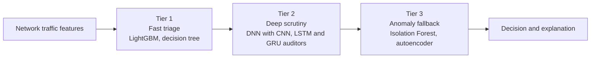

# SEDIKA: Case Study

**Secure Edge Domain-robust Intrusion Knowledge Architecture**

An intrusion detection system for IoT networks, built as part of my Ph.D. research at Mansoura University.

> **Status:** the research is under peer review (Computers & Security). The source code, trained models and numerical results are not public yet. They will be released after publication, and this page will be updated then.

---

## The problem

IoT intrusion detection models usually look excellent on the dataset they were trained on, but they are rarely tested against the conditions of a real deployment:

- **Noisy inputs.** Sensors and network captures are never as clean as a benchmark.
- **A different network.** A model trained on one environment is often used on another, where the traffic looks different.
- **False alarms.** A detector that fires too often gets ignored, so the false positive rate has to be a design target, not an afterthought.
- **Limited hardware.** Detection has to run at the edge, close to the device, with tight latency and power budgets.

SEDIKA is my attempt to design and evaluate a detector with those four conditions in mind.

## Approach

SEDIKA is a three-tier pipeline. Each tier has a different job and a different cost.

1. **Fast triage** uses lightweight classical models to handle common, known attack patterns quickly.
2. **Deep scrutiny** uses a class-weighted deep neural network for robust classification, with convolutional and recurrent models acting as specialist auditors.
3. **Anomaly fallback** uses an isolation forest and an autoencoder to flag traffic that falls outside what the classifiers were trained on.

## Main ideas

- **Robustness under noise.** I measure how each model family behaves as small amounts of noise are added to the input, and I use that evidence to decide which model should carry the decision.
- **Cross-domain transfer.** A feature-alignment module (built on CORAL and domain-adversarial training) adapts a model to a different network without any labels from the target network.
- **A false positive budget.** The autoencoder threshold is calibrated to a chosen false positive rate, instead of a fixed statistical cut-off.
- **Explainability.** SHAP explanations show which traffic features drive a decision, including how those explanations shift when noise is added.
- **Statistical validation.** Every model is evaluated across several random seeds and reported with its variation, not as a single run.

## Evaluation setup

- **Datasets:** RT-IoT2022 as the main benchmark and CICIoT2023 as the unseen target network for the cross-domain tests.
- **Models:** ten model architectures covering classical machine learning, deep learning and unsupervised anomaly detection.
- **Tests:** clean data, noisy data, adversarial perturbations and cross-domain transfer.

## My role

Researcher and developer: problem definition, architecture design, implementation, experiments and analysis.

**Tools:** Python, TensorFlow, LightGBM, XGBoost, scikit-learn, SHAP, Streamlit and Plotly.

## Availability

The code, models and detailed results will be published after the paper is accepted. Until then, I am happy to discuss the approach and methodology.

## Contact

[LinkedIn](https://www.linkedin.com/in/abdel-azeem-naser-b2b1a695/)
